<a href="https://osama-portfolio-side-projects.up.railway.app">
<picture>
  <source media="(max-width: 600px) and (prefers-color-scheme: dark)" srcset="assets/hero-mobile-dark.svg">
  <source media="(max-width: 600px)" srcset="assets/hero-mobile-light.svg">
  <source media="(prefers-color-scheme: dark)" srcset="assets/hero-dark.svg">
  
</picture>
</a>

  <a href="#selected-systems"><b>Work</b></a> &nbsp;·&nbsp;
  <a href="#how-a-call-becomes-a-finished-task"><b>Trace</b></a> &nbsp;·&nbsp;
  <a href="#the-stack"><b>Stack</b></a> &nbsp;·&nbsp;
  <a href="#ask-my-cv"><b>Ask my CV</b></a> &nbsp;·&nbsp;
  <a href="https://osama-portfolio-side-projects.up.railway.app/#intro-player"><b>Watch intro (2:12) ↗</b></a> &nbsp;·&nbsp;
  <a href="https://osama-portfolio-side-projects.up.railway.app"><b>Portfolio ↗</b></a> &nbsp;·&nbsp;
  <a href="https://www.linkedin.com/in/osamaifti"><b>LinkedIn ↗</b></a>

<picture>
  <source media="(max-width: 600px) and (prefers-color-scheme: dark)" srcset="assets/metrics-mobile-dark.svg">
  <source media="(max-width: 600px)" srcset="assets/metrics-mobile-light.svg">
  <source media="(prefers-color-scheme: dark)" srcset="assets/metrics-dark.svg">
  
</picture>

I build LLM systems that do the work, not just talk about it. Over 4+ years I've fine-tuned models, designed RAG layers, orchestrated multi-agent flows and put voice agents on real phone lines, then measured them after launch.

## Selected systems

<a href="https://myglobalhealth.online">
<picture>
  <source media="(max-width: 600px) and (prefers-color-scheme: dark)" srcset="assets/global-health-mobile-dark.svg">
  <source media="(max-width: 600px)" srcset="assets/global-health-mobile-light.svg">
  <source media="(prefers-color-scheme: dark)" srcset="assets/global-health-dark.svg">
  
</picture>
</a>

<a href="https://aerlou.com"><picture>
  <source media="(max-width: 600px) and (prefers-color-scheme: dark)" srcset="assets/aerlou-mobile-dark.svg">
  <source media="(max-width: 600px)" srcset="assets/aerlou-mobile-light.svg">
  <source media="(prefers-color-scheme: dark)" srcset="assets/aerlou-dark.svg">
  
</picture></a>
<a href="https://osama-portfolio-side-projects.up.railway.app/#work"><picture>
  <source media="(max-width: 600px) and (prefers-color-scheme: dark)" srcset="assets/aertonic-mobile-dark.svg">
  <source media="(max-width: 600px)" srcset="assets/aertonic-mobile-light.svg">
  <source media="(prefers-color-scheme: dark)" srcset="assets/aertonic-dark.svg">
  
</picture></a>

<a href="https://hirejordy.com"><picture>
  <source media="(max-width: 600px) and (prefers-color-scheme: dark)" srcset="assets/jordy-mobile-dark.svg">
  <source media="(max-width: 600px)" srcset="assets/jordy-mobile-light.svg">
  <source media="(prefers-color-scheme: dark)" srcset="assets/jordy-dark.svg">
  
</picture></a>
<a href="https://osama-portfolio-side-projects.up.railway.app/#work"><picture>
  <source media="(max-width: 600px) and (prefers-color-scheme: dark)" srcset="assets/dealeriq-mobile-dark.svg">
  <source media="(max-width: 600px)" srcset="assets/dealeriq-mobile-light.svg">
  <source media="(prefers-color-scheme: dark)" srcset="assets/dealeriq-dark.svg">
  
</picture></a>

<a href="https://osama-portfolio-side-projects.up.railway.app/#work"><picture>
  <source media="(max-width: 600px) and (prefers-color-scheme: dark)" srcset="assets/knowledge-search-mobile-dark.svg">
  <source media="(max-width: 600px)" srcset="assets/knowledge-search-mobile-light.svg">
  <source media="(prefers-color-scheme: dark)" srcset="assets/knowledge-search-dark.svg">
  
</picture></a>
<a href="https://osama-portfolio-side-projects.up.railway.app/#work"><picture>
  <source media="(max-width: 600px) and (prefers-color-scheme: dark)" srcset="assets/sbre-mobile-dark.svg">
  <source media="(max-width: 600px)" srcset="assets/sbre-mobile-light.svg">
  <source media="(prefers-color-scheme: dark)" srcset="assets/sbre-dark.svg">
  
</picture></a>

<b>Open the case files</b>: what each system does and what I owned

#### [Global Health](https://myglobalhealth.online) · AI Engineer, Team Lead for agent development · Jun 2025 – present
Multilingual LLM agents (English, Spanish, Portuguese, Czech) for patient intake, scheduling and FAQs across four clinic portals. ElevenLabs speech, real-time noise suppression and mid-call tool calling (calendar booking, CRM writes, live data) over Twilio: **92% task completion across 500+ live calls**. A RAG layer over clinical and admin knowledge keeps answers grounded, and low-confidence intents escalate to staff. Log analysis in Pandas reshaped the flows: **patient engagement up ~35%**.

#### [Aerlou](https://aerlou.com) · Product Lead, Ryzon Labs · 2024 – present
Intent parsing from voice notes and text, reminder and task extraction, and a persistent memory of people, preferences and expenses. Google Calendar, Meet and Gmail integration, plus OCR for receipts and PDFs. The call and SMS front desk resolves **~3 in 4 routine inbound calls without a human**. It's live with dental and healthcare clinics, real-estate agencies and dealerships.

#### Aertonic · Co-Founder & CTO, Ryzon Labs · 2024 – present
RFI drafting and auto-chasing, submittal review, compliance checks and change-order tracking, wired into Procore, Aconex and email. Every outbound action needs human approval. Early deployments: **documentation time down up to 65%, RFI cycle time down ~50%**.

#### [Jordy](https://hirejordy.com) · AI / Backend Engineer, Ryzon Labs · 2024 – present
Turns a natural-language ICP into a coordinated LinkedIn, email and X campaign, with follow-ups driven by reply sentiment. It matches tone, researches each lead before sending and adjusts its sequencing as it goes. **ICP to live campaign: from days to under an hour.**

#### DealerIQ · Led development, Hatzs Dimensions · 2023 – 2024
Automated cold calling, personalised email campaigns and lead scoring for dealerships. Multi-agent flows run on OpenAI Assistants and n8n, with live vehicle valuations from the Manheim API. **Manual first-pass outreach down an estimated 70%.**

#### Knowledge search · AI Team Lead, Hatzs Dimensions · 2023 – 2024
An open-source LLM fine-tuned on internal documents, with web retrieval and OCR for scanned tables. I built the dataset pipeline, shipped on Azure ML, then ran weeks of A/B tests across retrieval and prompting configs. **Average time-to-answer cut roughly in half.** Power BI dashboards track performance, tokens and adoption.

#### SBRE UAE · AI Engineer · Jul 2024 – Jun 2025
Lead-qualification agents using RAG over listings and CRM records, with per-client language switching. A Twilio SMS agent uses function calling to check inventory, trigger CRM workflows and send follow-ups. MLS extraction pipelines: **raw listings to analysis ~40% faster**.

#### Earlier · Blockchain Engineer, Fark Sky Technologies · 2022
Founding team for an NFT marketplace (just over **$1M in first-month sales**) and a token launch with **10,000+ active users in week one**.

## How a call becomes a finished task

<picture>
  <source media="(max-width: 600px) and (prefers-color-scheme: dark)" srcset="assets/pipeline-mobile-dark.svg">
  <source media="(max-width: 600px)" srcset="assets/pipeline-mobile-light.svg">
  <source media="(prefers-color-scheme: dark)" srcset="assets/pipeline-dark.svg">
  
</picture>

The demo is the easy part. What I put the effort into is underneath: **observability, retries, evals and rollback paths**. Those are the parts nobody demos, and they're why a system survives real usage.

## The stack

<picture>
  <source media="(max-width: 600px) and (prefers-color-scheme: dark)" srcset="assets/stack-mobile-dark.svg">
  <source media="(max-width: 600px)" srcset="assets/stack-mobile-light.svg">
  <source media="(prefers-color-scheme: dark)" srcset="assets/stack-dark.svg">
  
</picture>

<b>Full inventory</b>: all 67 tools

**AI systems:** `GPT` `Llama` `Mistral` `LLaVA` `BERT` `LoRA / PEFT` `Full fine-tuning` `RAG pipeline design` `Prompt engineering` `Function & tool calling` `Multi-agent orchestration` `NLP` `Deep learning` `CNN` `OpenAI API` `Azure OpenAI Service` `LangChain` `LlamaIndex` `Hugging Face` `ElevenLabs` `Whisper` `Hallucination-rate benchmarking` `Human-in-the-loop approval gating` `Model monitoring` `Grounded-response design` `Patient & CRM data across jurisdictions`

**Data & ML:** `PyTorch` `TensorFlow` `Keras` `Hugging Face Transformers` `scikit-learn` `Python` `Pandas` `NumPy` `Matplotlib` `SQL` `JavaScript` `Node.js` `R` `Power BI` `Tableau` `Statistical analysis` `Data pipelines` `OCR & document processing`

**Production engineering:** `MLflow` `Kubeflow` `DVC` `CI/CD` `Docker` `Kubernetes` `Azure ML` `Azure Functions` `Git` `Model serving` `Experiment tracking` `Model versioning` `Hyperparameter tuning` `A/B testing` `Evaluation (accuracy · hallucination rate · latency)` `Token-usage monitoring`

**Cloud & infrastructure:** `Microsoft Azure` `MySQL` `Hadoop` `Twilio` `n8n` `Salesforce` `Postman`

## Ask my CV

Tap a question. For anything else, the [live version on my portfolio](https://osama-portfolio-side-projects.up.railway.app/#ask) answers from my CV, with sources.

<b>› What has Osama shipped to production?</b>

 

- **Global Health:** multilingual voice and chat agents across four clinic portals. 92% task completion over 500+ live calls.
- **Aerlou:** a call and SMS front desk resolving ~3 in 4 routine calls without a human, live with clinics, agencies and dealerships.
- **Knowledge search:** a fine-tuned open-source LLM on Azure ML that cut time-to-answer roughly in half.
- **Jordy, SBRE and DealerIQ:** sales, real-estate and dealership agents running against real pipelines.

<b>› Has he fine-tuned LLMs himself?</b>

 

Yes. At Hatzs Dimensions he fine-tuned an open-source LLM on internal documents. He built the dataset and preprocessing pipeline from raw files, took it to production on Azure ML, then spent weeks on hyperparameter tuning and A/B testing against real usage. LoRA / PEFT and full fine-tuning are both in his toolkit.

<b>› How does he keep agents from hallucinating?</b>

 

He grounds answers first and lets the model generate second:
- **RAG** over clinical, policy and product knowledge keeps answers grounded rather than generated.
- **Confidence gates** send low-confidence intents to a human.
- **Approval gating** puts every outbound action behind human sign-off, as at Aertonic.
- **Evals** benchmark hallucination rate alongside accuracy and latency.

<b>› What voice-agent experience does he have?</b>

 

He built the Global Health voice agents in four languages. They use ElevenLabs speech, real-time noise suppression and mid-call tool calling for calendar booking, CRM writes and live data, deployed over Twilio. The result: 92% task completion over 500+ live calls. He also built Aerlou's call and SMS front desk, which routes by intent and books straight into the CRM.

<b>› Which cloud and MLOps tools does he use?</b>

 

- **Cloud:** Microsoft Azure, including Azure ML, Azure Functions and Azure OpenAI Service.
- **MLOps:** MLflow, Kubeflow and DVC.
- **Deployment:** Docker, Kubernetes and CI/CD.
- **Monitoring:** model performance, token use and adoption, tracked in Power BI.

<b>› Who is he, in his own words? (2-minute intro)</b>

 

[▶ Watch the intro on the portfolio](https://osama-portfolio-side-projects.up.railway.app/#intro-player). Captions are on by default.

`0:00` Who I am · `0:23` Industries & markets · `0:36` Healthcare voice agents · `0:57` Fine-tuning private LLMs · `1:15` How I pick problems · `1:32` What happens after launch · `1:51` Where I'm strongest

 

<a href="mailto:osamaifti@gmail.com">
<picture>
  <source media="(max-width: 600px) and (prefers-color-scheme: dark)" srcset="assets/connect-mobile-dark.svg">
  <source media="(max-width: 600px)" srcset="assets/connect-mobile-light.svg">
  <source media="(prefers-color-scheme: dark)" srcset="assets/connect-dark.svg">
  
</picture>
</a>

  Dubai, UAE · BSc Computer Science, dual major in AI & Data Science, Swinburne University of Technology 
  <a href="mailto:osamaifti@gmail.com">Email</a> &nbsp;/&nbsp;
  <a href="https://www.linkedin.com/in/osamaifti">LinkedIn</a> &nbsp;/&nbsp;
  <a href="https://osama-portfolio-side-projects.up.railway.app">Portfolio</a>

<code>console.log('why') // still no answer</code>

